<p align="center">
  
</p>

<p align="center">
  <a href="https://www.npmjs.com/package/@rama_nigg/open-cursor"></a>
  <a href="https://www.npmjs.com/package/@rama_nigg/open-cursor"></a>
  
</p>

<p align="center">
  <a href="https://nomadcxx.github.io/opencode-cursor/docs/">Documentation</a>
</p>

`open-cursor` connects OpenCode to the models available through your Cursor
subscription. It translates prompts, streaming responses, thinking, and tool
calls between OpenCode and Cursor (via a local openai-compatible proxy backed
by `@cursor/sdk`).

---

> **Also worth a look:** [oakimov/cursor-opencode-provider](https://github.com/oakimov/cursor-opencode-provider) takes a different approach, speaking Cursor's native agent protocol directly so OpenCode owns the tool loop. [opencode-plugin-compat](https://github.com/oakimov/opencode-plugin-compat) runs it unchanged on Kilo Code, MiMo Code, pi, oh-my-pi, and DeepSeek Harness. Excellent work.

## Installation

You need OpenCode, a Cursor subscription, the
[`cursor-agent` CLI](https://cursor.com/cli), and Node.js 20 or newer
(22.13 or newer if you use an API key, which runs the Cursor SDK).

### 1. Sign in to Cursor

```bash
cursor-agent login
```

That login is all open-cursor needs. An API key is optional (see
[Authentication](#authentication)).

### 2. Add the plugin

**OpenCode 2.x** (the current default). Add the package to `plugins` in
`~/.config/opencode/opencode.json` and restart OpenCode:

```json
{
  "plugins": ["@rama_nigg/open-cursor"]
}
```

Use the bare package name. OpenCode installs and updates it for you.

Coming from OpenCode 1.x? Delete `~/.config/opencode/plugin/cursor-acp.js`
first. OpenCode 2.x still loads files in that folder, so the old copy runs
next to the new one and requests can fail. See
[Moving from OpenCode 1.x to 2.x](#moving-from-opencode-1x-to-2x).

<details>
<summary><b>OpenCode 1.x</b></summary>

```bash
npm install -g @rama_nigg/open-cursor
open-cursor install
```

The installer adds the plugin and a `cursor-acp` provider block to your
OpenCode config, backing up the existing file first. Upgrade with
`npm update -g @rama_nigg/open-cursor`.

</details>

### 3. Check it works

```bash
opencode models | grep cursor-acp
opencode run -m cursor-acp/auto "Reply with PONG"
```

## Authentication

If `cursor-agent login` worked, you are done. open-cursor uses that login,
and you do not need to store anything in OpenCode.

On OpenCode 2.x, run `cursor-agent login` before you use `/connect`. The
**Log in with cursor-agent (browser)** option then picks up that login and
connects straight away.

| You want to | Do this |
|---|---|
| Use your Cursor login (default) | `cursor-agent login` |
| Connect Cursor in OpenCode 2.x | After `cursor-agent login`: `/connect` (TUI and Desktop) or `opencode auth login` → **Cursor** → **Log in with cursor-agent (browser)**. If `cursor-agent` is not logged in yet, it shows Cursor's sign-in link instead |
| Use an API key instead | `opencode auth login` → **Cursor** → API key (1.x: `opencode auth login --provider cursor-acp`), or set `CURSOR_API_KEY` |
| Remove a stored key (2.x) | `opencode auth logout cursor-acp`. Without an interactive terminal, add the credential label from `opencode auth list`: `opencode auth logout cursor-acp Cursor` |

API keys come from [cursor.com/settings](https://cursor.com/settings). With a
key stored, OpenCode 2.x runs requests through the Cursor SDK. If Cursor
rejects the key and `cursor-agent` is installed, open-cursor switches to
`cursor-agent` and logs a warning (keys set in `CURSOR_API_KEY` excepted:
`cursor-agent` reads that variable too, so unset a bad one). Do not enter a placeholder key to get past
the login prompt; choose **Log in with cursor-agent (browser)** instead.
On 2.x the newest login becomes the active account, so this also replaces a
stored key; `opencode auth switch cursor-acp <label>` switches back.

### Moving from OpenCode 1.x to 2.x

OpenCode 2.x reads the same `opencode.json`, so 1.x entries carry over. To
switch cleanly:

1. Delete `~/.config/opencode/plugin/cursor-acp.js` if the 1.x installer
   created it. OpenCode 2.x still loads it, so an old copy runs beside the
   new one and requests can fail with `cursor-agent exited with code 1 and
   no output`. `open-cursor doctor` flags the file.
2. Replace `"cursor-acp"` (or `@rama_nigg/open-cursor`) in the 1.x `plugin`
   list with the `plugins` entry above.
3. Delete the `provider.cursor-acp` block. On 2.x the plugin supplies models
   itself.
4. If requests fail with `Cursor rejected the API key`, remove the old stored
   key with `opencode auth logout cursor-acp`.

More detail: [OpenCode 2.0 setup](docs/opencode-2.md).

## Usage

Run a prompt with automatic model selection:

```bash
opencode run "Summarise this repository in five bullets." \
  --model cursor-acp/auto
```

You can also start `opencode` and choose a `cursor-acp/*` model from its model
picker.

## Documentation

- [Installation](https://nomadcxx.github.io/opencode-cursor/docs/getting-started/installation/)
- [OpenCode 2.0 setup](docs/opencode-2.md)
- [Authentication](https://nomadcxx.github.io/opencode-cursor/docs/getting-started/authentication/)
- [Configuration](https://nomadcxx.github.io/opencode-cursor/docs/reference/configuration/)
- [Choosing a model](https://nomadcxx.github.io/opencode-cursor/docs/guides/choosing-a-model/)
- [MCP servers](https://nomadcxx.github.io/opencode-cursor/docs/guides/mcp-servers/)
- [Troubleshooting](https://nomadcxx.github.io/opencode-cursor/docs/getting-started/troubleshooting/)
- [Architecture](https://nomadcxx.github.io/opencode-cursor/docs/architecture/overview/)
- [Development](https://nomadcxx.github.io/opencode-cursor/docs/development/building/)

## License

BSD-3-Clause

---

<a href="https://github.com/Nomadcxx"></a> — terminal-native tooling for the linux desktop.
[More projects →](https://github.com/Nomadcxx) · [Sponsor](https://github.com/sponsors/Nomadcxx) ❤️
